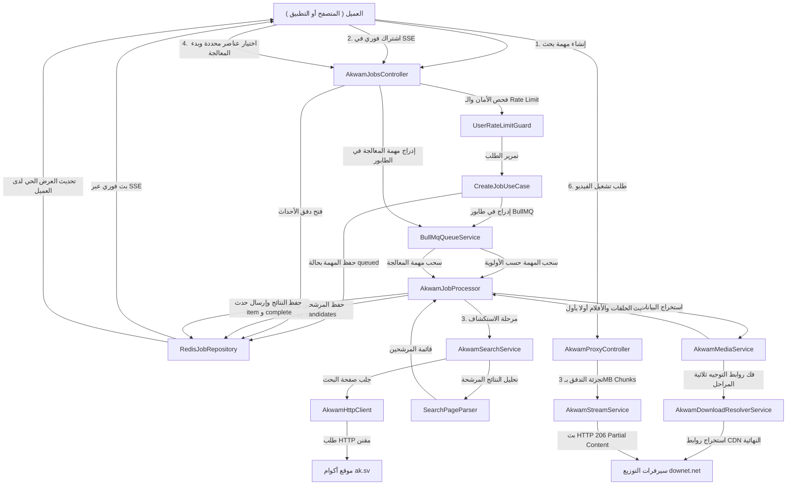
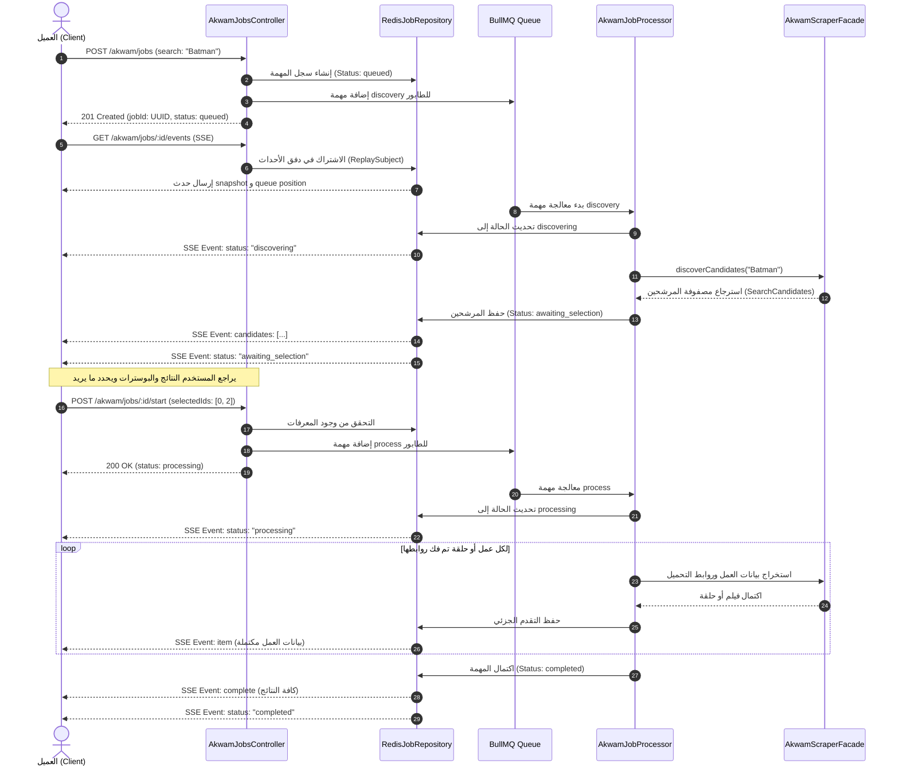
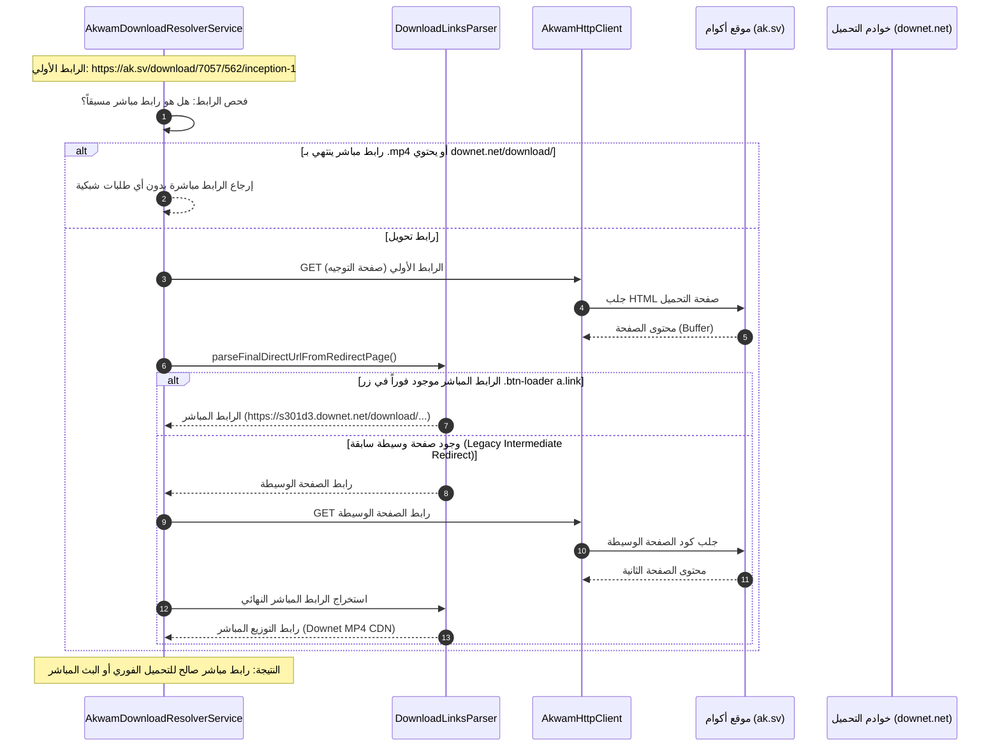
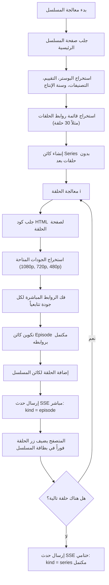
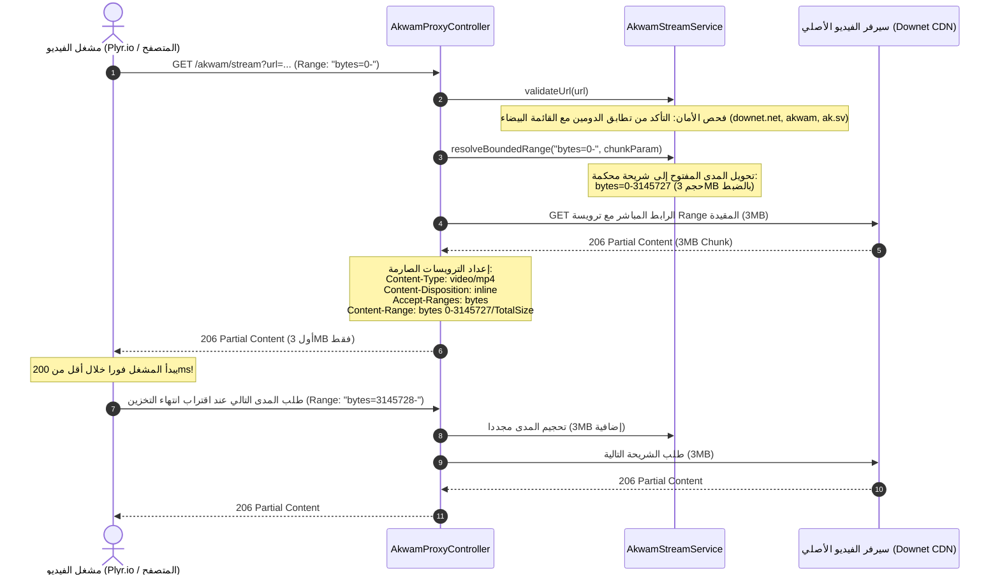
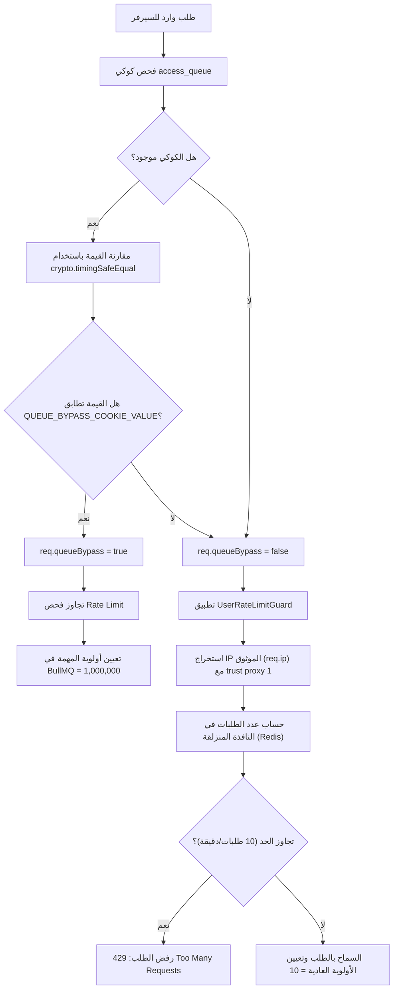
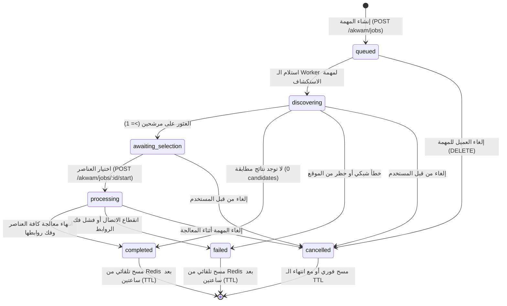
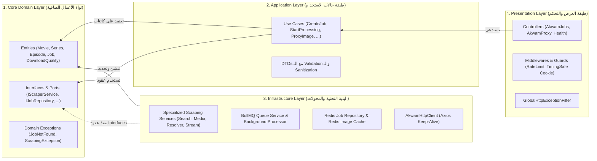

# 🔄 دليل ومخططات سير العمل الشاملة للنظام (Akwam System Workflows & Architecture Lifecycle)

> وثيقة هندسية تفصيلية تستعرض دورة حياة الطلبات، تدفق البيانات عبر طبقات المعمارية النظيفة (Clean Architecture)، خوارزميات فك التوجيه، استراتيجية التجزئة اللحظية لبث الفيديو، وإدارة الطوابير والأحداث المباشرة في منصة **akwam-nest**.

---

## 📑 فهرس المحتويات

1. [نظرة عامة على سير العمليات ومكونات النظام](#1-نظرة-عامة-على-سير-العمليات-ومكونات-النظام)
2. [المخطط الهيكلي العام للتدفق (Master Architecture Flow)](#2-المخطط-الهيكلي-العام-للتدفق-master-architecture-flow)
3. [دورة حياة المهمة غير التزامنية (Async Job Lifecycle)](#3-دورة-حياة-المهمة-غير-التزامنية-async-job-lifecycle)
4. [مرحلة الاستكشاف واختيار العناصر (Phase 1: Discovery & Candidate Selection)](#4-مرحلة-الاستكشاف-واختيار-العناصر-phase-1-discovery--candidate-selection)
5. [مرحلة المعالجة العميقة وحل الروابط (Phase 2: Deep Scraping & Link Resolution)](#5-مرحلة-المعالجة-العميقة-وحل-الروابط-phase-2-deep-scraping--link-resolution)
6. [خوارزمية فك الروابط المباشرة ثلاثية المراحل (3-Step Redirect Resolver)](#6-خوارزمية-فك-الروابط-المباشرة-ثلاثية-المراحل-3-step-redirect-resolver)
7. [مسار معالجة المسلسلات والبث اللحظي حلقة بحلقة (Series & Episodes Live Stream)](#7-مسار-معالجة-المسلسلات-والبث-اللحظي-حلقة-بحلقة-series--episodes-live-stream)
8. [سير عمل بروكسي بث الفيديو والتجزئة الذكية (Video Streaming Proxy & Bounded 206 Ranges)](#8-سير-عمل-بروكسي-بث-الفيديو-والتجزئة-الذكية-video-streaming-proxy--bounded-206-ranges)
9. [سير عمل بروكسي الصور والحماية من SSRF (Image Proxy & SSRF Defense)](#9-سير-عمل-بروكسي-الصور-والحماية-من-ssrf-image-proxy--ssrf-defense)
10. [سير عمل تخطي الطابور ومحدد السرعة (Rate Limiting & Admin Bypass)](#10-سير-عمل-تخطي-الطابور-ومحدد-السرعة-rate-limiting--admin-bypass)
11. [آلة حالات المهمة وإدارة الإلغاء والأخطاء (Job State Machine & Failure Recovery)](#11-آلة-حالات-المهمة-وإدارة-الإلغاء-والأخطاء-job-state-machine--failure-recovery)
12. [تدفق البيانات بين طبقات المعمارية (Data Flow Across Clean Layers)](#12-تدفق-البيانات-بين-طبقات-المعمارية-data-flow-across-clean-layers)

---

## 1. نظرة عامة على سير العمليات ومكونات النظام

يعتمد نظام **akwam-nest** على نمط **المعالجة غير التزامنية المرحلية (Two-Phase Async Pipeline)** المدعوم بطابور مهام **BullMQ** وقاعدة بيانات **Upstash Redis (TLS)**، لضمان عدم حجب موارد الخادم (Non-blocking I/O) وتوفير تجربة مستخدم سلسة حتى أثناء معالجة مسلسلات ضخمة تضم عشرات الحلقات.

### المكونات الفاعلة في سير العمل (System Actors):
* **العميل (Client Application):** المتصفح أو تطبيق الهاتف أو واجهة Swagger التي تبدأ الطلب وتستمع للأحداث الحية عبر Server-Sent Events (SSE).
* **طبقة الواجهة والتحكم (Presentation Layer):** تستقبل الطلبات، وتطبق محدد السرعة (Rate Limiting)، وتتحقق من كوكي الأدمن، وتفحص المدخلات عبر الـ DTOs و ValidationPipe.
* **طبقة حالات الاستخدام (Application Use Cases):** تنسق منطق الأعمال المستقل عن البنية التحتية.
* **طابور المهام (BullMQ Worker & Redis Queue):** يدير أولويات المهام، وتوزيع المعالجة، والتحكم في التزامن (Concurrency).
* **مستودع الحالة والأحداث (Redis Job Repository):** يخزن لقطة حالة المهمة (Snapshot) مع TTL تلقائي (ساعتان)، ويدير قنوات البث (Pub/Sub) ومخزن الذاكرة التراكمي `ReplaySubject(10)`.
* **محرك التجريف والتحليل (Infrastructure Scraping Engine):** يضم عميل HTTP ذو الاتصال المستمر (Keep-Alive)، ومحللات Cheerio المعزولة، ومفكك الروابط ثلاثي المراحل.
* **بروكسي الفيديو (Streaming Service):** يتولى جلب وتجزئة تدفق الفيديو بطلب أجزاء محددة (Byte-Ranges) وتمريرها للمشغل عبر HTTP 206.

---

## 2. المخطط الهيكلي العام للتدفق (Master Architecture Flow)

يوضح المخطط التالي المسار الإجمالي الذي يسلكه أي استعلام داخل المنظومة:



---

## 3. دورة حياة المهمة غير التزامنية (Async Job Lifecycle)

تتألف دورة حياة المهمة من مرحلتين منفصلتين ومحطات تحقق دقيقة لتفادي استنزاف موارد السيرفر:



---

## 4. مرحلة الاستكشاف واختيار العناصر (Phase 1: Discovery & Candidate Selection)

تعتبر هذه المرحلة صمام الأمان للنظام؛ بدلاً من الزحف العشوائي وتحميل جميع روابط نتائج البحث، يتم فقط سحب العناوين والصور لتوفير 95% من وقت المعالجة واستهلاك الشبكة.

```mermaid
flowchart LR
    Start(["بدء البحث"]) --> ReqSearch["طلب صفحة البحث: ak.sv/search?q=..."]
    ReqSearch --> RateCheck{"فحص محدد السرعة (Token Bucket)"}
    RateCheck -->|مسموح| FetchHTML["جلب كود HTML عبر Axios Keep-Alive"]
    RateCheck -->|مكتظ| DelayQueue["انتظار توفر Token في الخزان"]
    DelayQueue --> FetchHTML
    
    FetchHTML --> CheerioLoad["تحميل الصفحة في Cheerio"]
    CheerioLoad --> QueryCards["استخراج كروت النتائج (.entry-box)"]
    
    QueryCards --> ExtractData["استخراج: العنوان + الرابط + البوستر"]
    ExtractData --> ImageFallback{"هل البوستر مباشر أم Lazy؟"}
    ImageFallback -->|data-src| TakeDataSrc["اعتماد data-src"]
    ImageFallback -->|srcset| TakeSrcset["استخراج أعلى دقة من srcset"]
    ImageFallback -->|src| TakeSrc["اعتماد src"]
    
    TakeDataSrc --> BuildCandidate["بناء كائن SearchCandidate"]
    TakeSrcset --> BuildCandidate
    TakeSrc --> BuildCandidate
    
    BuildCandidate --> CheckCount{"هل توجد نتائج؟"}
    CheckCount -->|نعم| SetAwaiting["الحالة: awaiting_selection"]
    CheckCount -->|لا| SetCompletedEmpty["الحالة: completed (نتائج فارغة)"]
    
    SetAwaiting --> PublishSSE["بث مصفوفة المرشحين للمستخدم"]
    SetCompletedEmpty --> PublishSSE
```



---

## 5. مرحلة المعالجة العميقة وحل الروابط (Phase 2: Deep Scraping & Link Resolution)

عندما يختار العميل المعرفات المطلوبة (مثلاً: الفيلم رقم 0 والحلقة رقم 3)، تنطلق المعالجة العميقة:

```mermaid
flowchart TD
    SelectNode["استلام selectedIds من العميل"] --> ValidateIds{"التحقق من صحة المعرفات"}
    ValidateIds -->|غير صالحة| Throw400["إرجاع خطأ 400 Bad Request"]
    ValidateIds -->|صالحة| FetchDetails["جلب صفحة تفاصيل العمل"]
    
    FetchDetails --> TypeCheck{"هل المحتوى فيلم أم مسلسل؟"}
    
    TypeCheck -->|فيلم (Movie)| ParseMovie["تحليل تفاصيل الفيلم والجودات"]
    ParseMovie --> ResolveMovie["فك روابط تحميل الجودات تتابعياً"]
    ResolveMovie --> SaveMovie["تحديث سجل الفيلم وبث حدث item"]
    
    TypeCheck -->|مسلسل (Series)| ParseSeries["تحليل تفاصيل المسلسل وروابط الحلقات"]
    ParseSeries --> LoopEpisodes["حلقة تكرارية على صفحات الحلقات"]
    LoopEpisodes --> ParseEp["جلب صفحة الحلقة واستخراج الجودات"]
    ParseEp --> ResolveEp["فك روابط تحميل الحلقة تتابعياً"]
    ResolveEp --> EmitEp["بث حدث لحظي للحلقة المكتملة (Live Episode Stream)"]
    EmitEp --> NextEp{"هل بقيت حلقات أخرى؟"}
    NextEp -->|نعم| LoopEpisodes
    NextEp -->|لا| CompleteSeries["تحديث كائن المسلسل كاملاً وبث حدث item"]
    
    SaveMovie --> CheckAllDone{"هل اكتملت كل العناصر المختارة؟"}
    CompleteSeries --> CheckAllDone
    
    CheckAllDone -->|نعم| MarkDone["حالة المهمة: completed وبث حدث complete"]
```

---

## 6. خوارزمية فك الروابط المباشرة ثلاثية المراحل (3-Step Redirect Resolver)

يقوم موقع أكوام بحماية روابط التحميل المباشرة وإخفائها خلف روابط تحويل متعددة وصفحات وسيطة لحماية سيرفرات CDN. يتولى `AkwamDownloadResolverService` حل هذه التعقيدات آلياً:



---

## 7. مسار معالجة المسلسلات والبث اللحظي حلقة بحلقة (Series & Episodes Live Stream)

أحد أبرز الابتكارات في النظام هو **عدم إجبار المستخدم على انتظار معالجة المسلسل بالكامل** (الذي قد يستغرق دقيقة أو دقيقتين للمسلسلات الطويلة)، بل يتم بث كل حلقة للمتصفح لحظة فك روابطها:



---

## 8. سير عمل بروكسي بث الفيديو والتجزئة الذكية (Video Streaming Proxy & Bounded 206 Ranges)

عند تشغيل الفيديو داخل مشغل `Plyr.io`، ترسل المتصفحات ترويسة Range مفتوحة (`bytes=0-` أو `bytes=3145728-`). إذا تم تمرير هذا الطلب كما هو لمصدر الفيديو، سيقوم بتحميل الملف كاملاً (قد يصل لـ 4 جيجابايت) مما يستهلك رامات السيرفر وذاكرة المتصفح ويسبب بطئاً وتجميداً.

يقوم `AkwamStreamService` بتطبيق **خوارزمية التجزئة التقدمية (Bounded Progressive Chunking)**:



---

## 9. سير عمل بروكسي الصور والحماية من SSRF (Image Proxy & SSRF Defense)

لمنع مشاكل حظر الـ Hotlinking و CORS، ولحماية السيرفر من هجمات اختراق الشبكات الداخلية (SSRF)، يسلك طلب الصور المسار التالي:

```mermaid
flowchart TD
    ReqImg["طلب صورة: GET /akwam/proxy-image?url=..."] --> CheckRate["محدد سرعة مخصص للصور (150 طلب/دقيقة)"]
    CheckRate -->|تجاوز الحد| Err429["429 Too Many Requests"]
    CheckRate -->|مسموح| ValidateUrl["فحص الرابط أمنياً"]
    
    ValidateUrl --> CheckProtocol{"البروتوكول HTTPS فقط؟"}
    CheckProtocol -->|لا| Err400Proto["400 Bad Request: بروتوكول مرفوض"]
    CheckProtocol -->|نعم| CheckDomain{"الدومين ضمن القائمة البيضاء المصرحة؟"}
    
    CheckDomain -->|لا| Err400Host["400 Bad Request: دومين غير مصرح"]
    CheckDomain -->|نعم| CheckDNS{"فحص DNS: هل يشير لـ Private IP أو Metadata؟"}
    
    CheckDNS -->|نعم: 127.0.0.1, 10.x, 169.254.x| Err400SSRF["400 Bad Request: محاولة SSRF محظورة"]
    CheckDNS -->|لا: IP عام نظيف| CheckCache{"فحص كاش الصور في Redis"}
    
    CheckCache -->|موجود في الكاش| ReturnCached["إرجاع البايتات المخزنة مباشرة مع Content-Type"]
    CheckCache -->|غير موجود| FetchUpstream["طلب الصورة من السيرفر المصدر"]
    
    FetchUpstream --> SecurityOpts["خيارات: maxRedirects: 0، maxContentLength: 5MB"]
    SecurityOpts --> CheckContentType{"هل ترويسة Content-Type صورة فعلية؟"}
    
    CheckContentType -->|لا (HTML / Executable)| Err400Mime["400 Bad Request: المحتوى ليس صورة"]
    CheckContentType -->|نعم (image/jpeg, png, webp)| StoreRedis["حفظ في Redis مع TTL = 24 ساعة"]
    
    StoreRedis --> SendResponse["إرسال بايتات الصورة مع Cache-Control: max-age=86400"]
    ReturnCached --> SendResponse
```

---

## 10. سير عمل تخطي الطابور ومحدد السرعة (Rate Limiting & Admin Bypass)

يتضمن النظام خط دفاع مزدوج لحماية الموارد مع إمكانية منح مسؤولي النظام أولوية فائقة وتجاوز الحدود:



---

## 11. آلة حالات المهمة وإدارة الإلغاء والأخطاء (Job State Machine & Failure Recovery)

تتبع المهمة آلة حالات صارمة (Finite State Machine) تضمن عدم حدوث تضارب، مع إمكانية إلغاء المهمة في أي لحظة:



---

## 12. تدفق البيانات بين طبقات المعمارية (Data Flow Across Clean Layers)

تطبيقاً صارماً لمبادئ المعمارية النظيفة (Clean Architecture)، تسير البيانات في اتجاه أحادي من الخارج إلى الداخل مع التزام قاعدة التبعية (Dependency Rule):



---

> **خلاصة:**
> هذا السير الممنهج يضمن أن النظام لا يتعطل حتى مع ذروة الاستخدام، ويحفظ ذاكرة الخادم من التسريب (Zero Memory Leak) بفضل التخزين المؤقت في Redis بـ TTL، كما يضمن استجابة فورية لمشغل الفيديو وأماناً عالي المستوى ضد شتى التهديدات السيبرانية.
